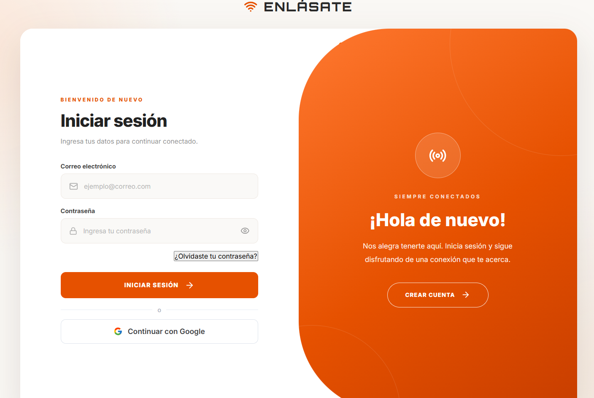
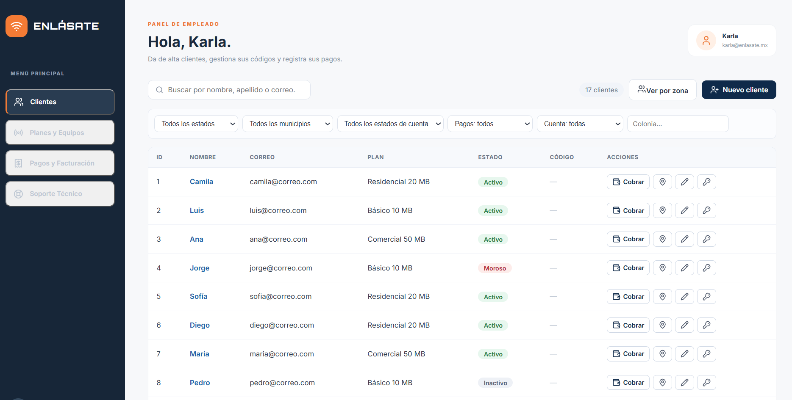
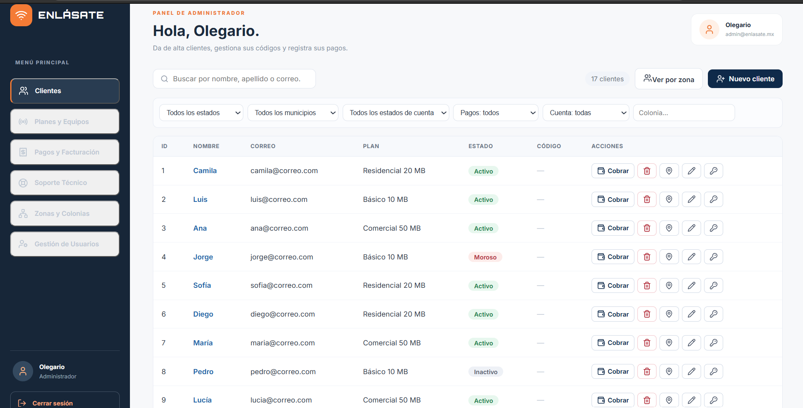
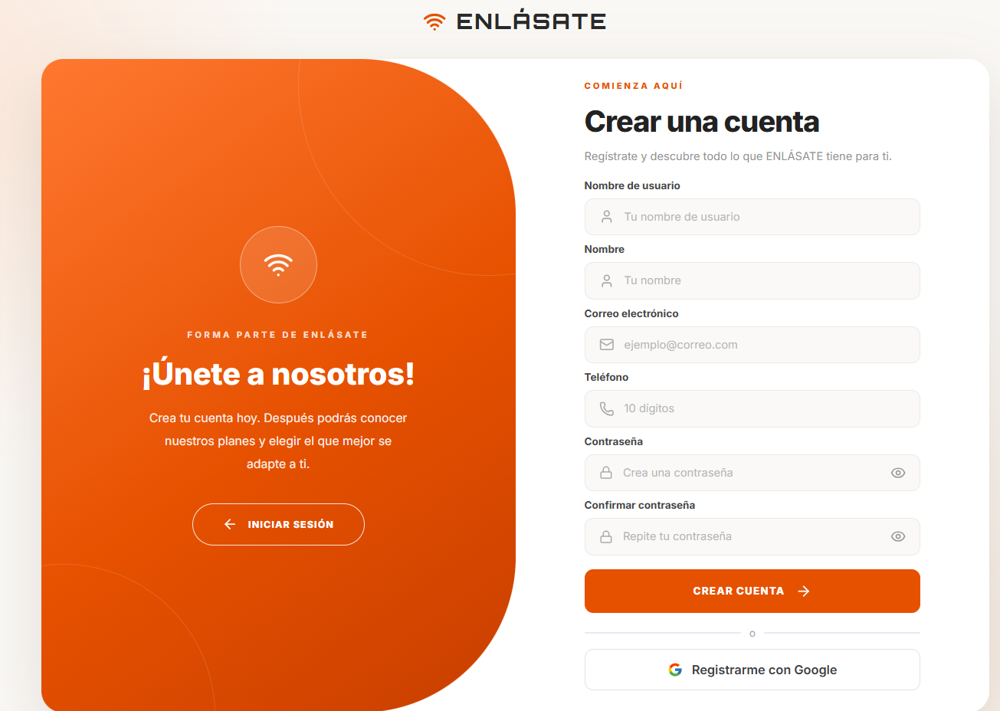
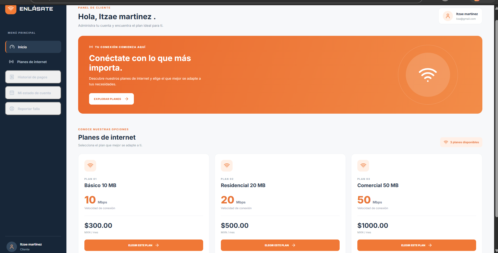
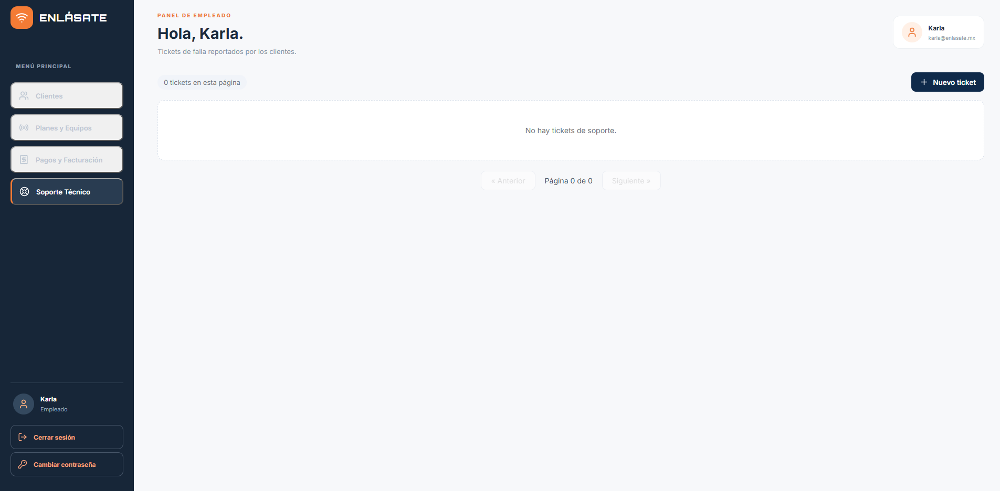
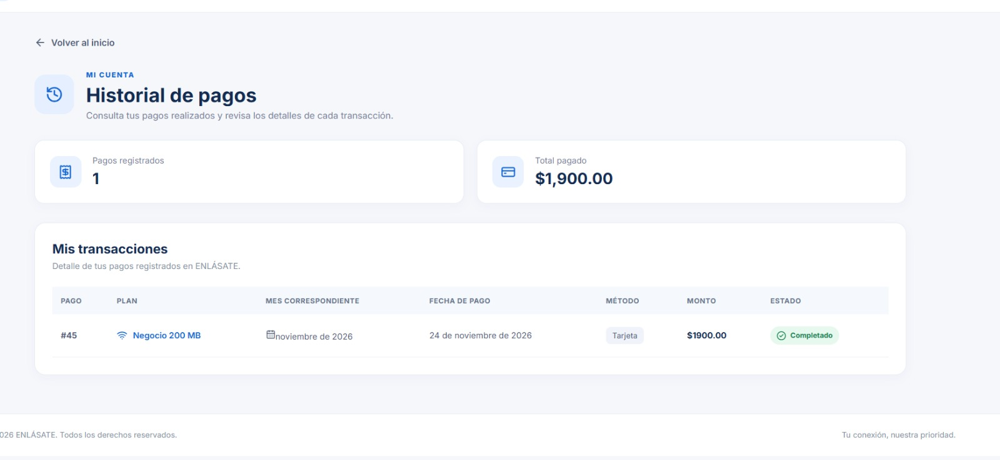
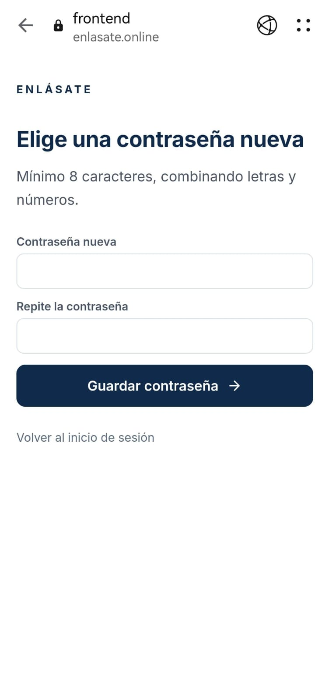

# ENLÁSATE
### Sistema web de gestión de servicios de Internet

## 1. Descripción del proyecto

ENLÁSATE es una aplicación web desarrollada para la gestión de servicios de un proveedor de Internet. Su propósito es facilitar la contratación y administración de planes de Internet, así como permitir el control de pagos, equipos, notificaciones y soporte técnico.

La plataforma cuenta con diferentes tipos de usuarios, cada uno con funcionalidades específicas de acuerdo con sus permisos:


- **Cliente:** puede registrarse, iniciar sesión, consultar y contratar planes, realizar pagos simulados, consultar su historial de pagos, revisar mensualidades pendientes y solicitar soporte técnico.

- **Empleado:** puede gestionar las solicitudes de soporte y realizar actividades relacionadas con la atención a los clientes.

- **Administrador:** tiene acceso a las funciones administrativas del sistema, incluyendo la gestión de usuarios, planes y operaciones generales.


El sistema utiliza autenticación mediante JSON Web Tokens (JWT) para proteger los recursos y controlar el acceso según el rol del usuario.

## 2. Objetivo general

Desarrollar una aplicación web que permita administrar de manera eficiente los servicios de un proveedor de Internet, facilitando la interacción entre clientes, empleados y administradores mediante una plataforma segura, organizada y accesible.

## 3. Tecnologías utilizadas

### Frontend
- React 19
- JavaScript
- Vite
- HTML5
- CSS3
- Axios
- React Router DOM
- Lucide React

### Backend
- Java 23
- Spring Boot 4.2.0
- Spring Web
- Spring Data JPA
- Spring Security
- JSON Web Token (JWT)
- Maven

### Base de datos
- MySQL 9.2
- MySQL Workbench
- Flyway para el control de versiones y migraciones de la base de datos.

### Herramientas de desarrollo
- Visual Studio Code
- Git
- GitHub
- Bruno para pruebas de API.

## 4. Arquitectura del sistema

El proyecto utiliza una arquitectura cliente-servidor dividida en tres componentes principales:

1. **Frontend:** desarrollado con React, encargado de la interfaz gráfica y la interacción con los usuarios.
2. **Backend:** desarrollado con Spring Boot, encargado de la lógica de negocio, autenticación, validaciones y comunicación con la base de datos.
3. **Base de datos:** desarrollada en MySQL, encargada del almacenamiento y administración de la información.

La comunicación entre el frontend y el backend se realiza mediante peticiones HTTP utilizando una API REST.


## 5. Funcionalidades principales

### Módulo de clientes
- Registro de nuevos usuarios.
- Inicio y cierre de sesión.
- Consulta de información personal.
- Visualización de planes de Internet.
- Contratación y selección de planes.
- Consulta del plan contratado.
- Consulta de pagos realizados.
- Visualización de mensualidades pendientes.
- Selección de métodos de pago.
- Consulta de notificaciones.
- Solicitud de soporte técnico.


### Módulo de empleados
- Acceso mediante autenticación.
- Consulta y atención de solicitudes de soporte técnico.
- Gestión de actividades relacionadas con los clientes.


### Módulo de administración
- Acceso exclusivo para administradores.
- Administración de información del sistema.
- Gestión de usuarios y planes.
- Consulta y seguimiento de operaciones.

### Módulo de pagos
El sistema implementa un mecanismo de pagos simulados. No se realizan transacciones bancarias reales.


El proceso contempla:
- Selección del plan contratado.
- Selección del método de pago.
- Registro del pago.
- Actualización del estado del pago.
- Consulta del historial de pagos.
- Seguimiento de mensualidades pendientes.
- Activación del servicio cuando el pago correspondiente es aprobado.


### Recuperación de contraseña
- Solicitud de recuperación mediante correo electrónico.
- Generación de un token de recuperación.
- Restablecimiento de contraseña mediante un enlace seguro.


## 6. Estructura del proyecto

```text
ENLASATE/
│
├── backend/
│   ├── src/
│   │   └── main/
│   │       ├── java/
│   │       └── resources/
│   ├── pom.xml
│   ├── mvnw
│   └── mvnw.cmd
│
├── frontend/
│   ├── public/
│   ├── src/
│   │   ├── components/
│   │   ├── pages/
│   │   ├── services/
│   │   ├── assets/
│   │   ├── App.jsx
│   │   └── App.css
│   └── package.json
│
├── bruno/
│   └── Colecciones de pruebas de API
│
├── database/
│   └── Respaldo de la base de datos
│
├── README.md
└── .gitignore
```

## 7. Base de datos

El sistema utiliza MySQL como sistema de gestión de bases de datos.

**Nombre de la base de datos:**

```sql
enlasate_db
```

La estructura de la base de datos se administra mediante migraciones de Flyway, lo que permite mantener un control de versiones sobre los cambios realizados en el esquema.

Se utiliza la configuración:

```properties
spring.jpa.hibernate.ddl-auto=validate
spring.flyway.enabled=true
```

De esta manera, Hibernate valida la estructura de las entidades sin crear o modificar automáticamente las tablas.

### Diagrama entidad-relación

El siguiente diagrama representa las principales relaciones conceptuales de la base de datos.

.png)


### 8.1 Clonar el repositorio

```bash
git clone https://github.com/camicrts5-hash/Proyecto_Final_Eq16.git
```

Entrar al directorio:

```bash
cd Proyecto_Final_Eq16
```

### 8.2 Configurar la base de datos

Crear la base de datos en MySQL:

```sql
CREATE DATABASE enlasate_db;
```

Configurar las credenciales de conexión en:

```text
backend/src/main/resources/application.properties
```

Ejemplo de configuración:

```properties
spring.datasource.url=jdbc:mysql://localhost:3306/enlasate_db
spring.datasource.username=TU_USUARIO
spring.datasource.password=TU_CONTRASEÑA

spring.jpa.hibernate.ddl-auto=validate
spring.flyway.enabled=true
spring.jpa.show-sql=true
```

Las credenciales deben sustituirse por las correspondientes al entorno local.

Las migraciones de Flyway se ejecutan al iniciar el backend.

### 8.3 Ejecutar el backend

Abrir una terminal dentro de la carpeta `backend`:

```bash
cd backend
```

Ejecutar:

```bash
./mvnw spring-boot:run
```

En Windows también puede utilizarse:

```bash
mvnw.cmd spring-boot:run
```

El backend estará disponible en:

```text
http://localhost:8080
```

### 8.4 Ejecutar el frontend

Abrir otra terminal dentro de la carpeta `frontend`:

```bash
cd frontend
```

Instalar las dependencias:

```bash
npm install
```

Iniciar el servidor de desarrollo:

```bash
npm run dev
```

El frontend estará disponible en:

```text
http://localhost:5173
```

## 9. Seguridad y autenticación

ENLÁSATE implementa mecanismos de seguridad mediante Spring Security y JWT.

Entre sus características se encuentran:

- Autenticación de usuarios.
- Generación y validación de tokens JWT.
- Protección de rutas y recursos.
- Control de acceso basado en roles.
- Validación de credenciales.
- Recuperación de contraseñas mediante tokens.

Los usuarios únicamente pueden acceder a las funcionalidades autorizadas para su rol.


## 10. Consideraciones importantes

- La aplicación utiliza MySQL, no MariaDB.
- Los pagos son simulados y no representan transacciones bancarias reales.
- La base de datos se administra mediante migraciones de Flyway.
- Las contraseñas no deben almacenarse en texto plano.
- Las credenciales de conexión y otros datos sensibles no deben publicarse en el repositorio.
- El acceso a los recursos está protegido mediante autenticación y autorización.

## 11. Equipo de desarrollo

**Proyecto:** ENLÁSATE  
**Tipo:** Aplicación web  
**Área:** Desarrollo de software  
**Repositorio:** [Proyecto_Final_Eq16](https://github.com/camicrts5-hash/Proyecto_Final_Eq16)
**Figma:** ## 4. Diseño y prototipado

El diseño de la interfaz de ENLÁSATE fue realizado utilizando Figma, donde se desarrolló un mockup para representar la estructura visual, navegación y experiencia de usuario del sistema.

El prototipo permite visualizar las diferentes pantallas y módulos de la aplicación, considerando las funcionalidades correspondientes a clientes, empleados y administradores.

**Prototipo de Figma:**
(https://www.figma.com/proto/LVr4ejp5KsHn1CJy1husVn/Mockup-Sistema-Web---Equipo-16?node-id=54764-19&m=dev&scaling=min-zoom&content-scaling=fixed&page-id=0%3A1&starting-point-node-id=2%3A2&t=wDb4CVlb4MKcuGMt-1)


### Aplicación web
**Enlace de acceso:** (https://enlasate.online/login)
 
 ### Projects
 https://github.com/users/camicrts5-hash/projects/4
 ### URL de backend
API REST:  https://enlasate.online/api
Servidor de aplicación: Spring Boot 4.2 (Java 21), puerto interno 8080
Proxy inverso: Nginx con HTTPS (Let's Encrypt)
Base de datos: MySQL 8.4.13 en puerto interno 3307 
---